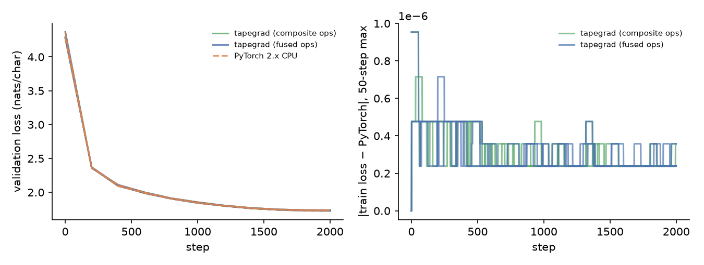
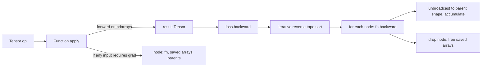

# tapegrad

Reverse-mode automatic differentiation and a NumPy tensor library written from scratch. It trains a character-level transformer to the same loss curve as PyTorch, matching to within a few float32 rounding units at every step, from identical weights and batches.

[](https://github.com/eshaan2418/tapegrad/actions/workflows/ci.yml)
[](LICENSE)


## Headline result

4-layer GPT, 818k parameters, trained for 2,000 AdamW steps on Tiny Shakespeare. Each run starts from the same initial weights and sees the same batches in both libraries. Values are mean ± 95% CI over 3 seeds, measured on an Apple M5 CPU.

| | final val loss (nats/char) | max \|loss − PyTorch\| over 2,000 steps | steps where the loss is bit-identical | train steps/s |
|---|---|---|---|---|
| **tapegrad** | 1.7317 ± 0.0115 | ≤ 9.5e-7 | 41-44% | 14.1 ± 6.3 |
| PyTorch 2.x CPU | 1.7317 ± 0.0115 | - | - | 23.0 ± 7.3 |

The gap never grows during training. It stays at 1-4 float32 ULPs of the loss value (right panel). In float64, losses, all parameter gradients, and 30 steps of AdamW with gradient clipping agree with PyTorch to below 1e-9.



## Demo

```
$ tapegrad sample --weights runs/tapegrad_s0.npz --prompt "ROMEO:" --tokens 300
ROMEO:
Ge to thou tell not be quuther both to me:
I'll their beffeech himself; where's not thought
Would thee, must say though it her bed,
She purpose watch have were merre to humbours;
...
```

(An 818k-parameter character model after 2,000 steps produces Shakespeare-shaped text, not Shakespeare.)

## Why this exists

Autodiff is the part of every deep learning framework that people use daily and rarely see. Small educational engines (scalar autograd, toy tensor libraries) show the idea but are rarely held to a strict standard. Can it train a real model, and does it get the same answer as a production framework? tapegrad holds itself to that standard. Every op is gradient-checked against PyTorch on random, broadcasting shapes. A full transformer training run is compared step by step against PyTorch from identical initialisation. The same harness then measures the systems questions: what fusing ops buys in memory and speed, and what freeing the tape during backward buys.

## Highlights

- **Every op checked against PyTorch autograd** in float64 with Hypothesis-generated shapes: all broadcastable shape pairs for binary ops, reductions over every axis, batched and broadcast matmul (including 1-D operands), indexing with repeated and negative indices, softmax, log-softmax, LayerNorm, and cross-entropy. There are also independent finite-difference checks.
- **Training-trajectory parity.** Parameter names and layouts mirror `torch.nn`, so weights copy one-to-one. AdamW, SGD with Nesterov, and gradient clipping reproduce PyTorch's update rules exactly (float64 trajectory test).
- **Fused vs composite ops.** Softmax, LayerNorm, and cross-entropy exist both as hand-derived fused backward passes and as compositions of primitives. Fusing cuts the tape after forward by 20% (173 vs 217 MB).
- **Profiled, not guessed.** Two hot spots found by cProfile brought a training step from 10.9 to 18.1 steps/s: float `np.power` in GELU (now 4.6x faster) and `np.add.at` in indexing backward, replaced by a sort plus segment-sum. A test written for that fix caught a negative-index aliasing bug.
- **Iterative topological sort** (a 5,000-op chain backpropagates fine), gradient accumulation for fan-out, `no_grad`, and tape freeing during backward.

## Quick start

```bash
git clone https://github.com/eshaan2418/tapegrad && cd tapegrad
make setup          # uv venv + install (torch is a dev/eval dependency, used only for checks)
make test           # gradient checks + PyTorch parity
make data           # Tiny Shakespeare (1.1 MB, checksum-verified)
make train          # 9 runs: tapegrad fused / composite / PyTorch x 3 seeds (~20 min)
make bench plots    # speed + memory benchmark, tables and figures
make demo           # sample from the trained model
```

```python
import numpy as np
from tapegrad.tensor import Tensor
x = Tensor(np.random.randn(3, 4), requires_grad=True)
w = Tensor(np.random.randn(4, 2), requires_grad=True)
loss = (x @ w).tanh().sum()
loss.backward()
print(w.grad.shape)    # (4, 2)
```

## Method



Each op implements `forward(ctx, *arrays)` and `backward(ctx, grad) -> grads`. Broadcasting follows NumPy. A gradient flowing into a broadcast input is summed over added leading axes and over axes where the input had size 1. Two fused backward passes do most of the work in the transformer:

- cross-entropy: `∂L/∂z = (softmax(z) − onehot(y)) / N`, saving only the probabilities;
- LayerNorm: `∂L/∂x = (1/σ)/n · (n·ĝ − Σĝ − x̂·Σ(ĝ·x̂))` with `ĝ = g·w`, saving `x̂` and `1/σ`.

More in [docs/DESIGN.md](docs/DESIGN.md).

## Results

Hardware: Apple M5 (18 cores), macOS 27.0.1, NumPy 2.5.4 (OpenBLAS), PyTorch 2.14.1 CPU, Python 3.12.14. Model: 4 layers, 4 heads, d=128, context 64, batch 32, AdamW lr 1e-3 (100-step warmup, cosine), weight decay 0.1, gradient clipping 1.0, float32. Raw results: `eval/results/`. Tables are generated by `scripts/make_tables.py` into [eval/results/tables.md](eval/results/tables.md).

### Training (3 seeds, 2,000 steps)

| implementation | final val loss | train steps/s during the run | peak RSS MB |
|---|---|---|---|
| tapegrad, fused ops | 1.7317 ± 0.0115 | 14.1 ± 6.3 | 361 |
| tapegrad, composite ops | 1.7317 ± 0.0115 | 12.7 ± 5.4 | 515 |
| PyTorch CPU | 1.7317 ± 0.0115 | 23.0 ± 7.3 | 447 |

Per-seed agreement with PyTorch:

| seed | variant | max \|Δ train loss\| | at step | bit-identical steps | final \|Δ val loss\| |
|---|---|---|---|---|---|
| 0 | fused | 4.77e-07 | 3 | 40.6% | 1.19e-08 |
| 1 | fused | 9.54e-07 | 1 | 43.8% | 5.96e-09 |
| 2 | fused | 4.77e-07 | 3 | 41.8% | 1.79e-08 |
| 0 | composite | 4.77e-07 | 3 | 40.6% | 5.96e-09 |
| 1 | composite | 9.54e-07 | 1 | 43.0% | 1.19e-08 |
| 2 | composite | 7.15e-07 | 33 | 42.8% | 7.15e-08 |

The largest gap occurs in the first few steps, when the loss is largest (about 4.2, where one float32 ULP is 4.8e-7). It does not compound.

### Speed

Median of 7 interleaved repeats of 60 steps. The machine was running a GPU training job in another process throughout, and the min-max ranges show that load. Only the coarse ratios should be read from this table.

| implementation | BLAS threads | steps/s (median) | min-max | vs PyTorch |
|---|---|---|---|---|
| tapegrad, fused | 1 | 16.1 | 10.6-17.1 | 0.89x |
| tapegrad, composite | 1 | 13.0 | 3.7-16.6 | 0.72x |
| PyTorch | 1 | 18.1 | 10.2-21.4 | 1.00x |
| tapegrad, fused | 4 | 13.9 | 7.6-18.3 | 0.56x |
| tapegrad, composite | 4 | 15.1 | 7.9-17.2 | 0.61x |
| PyTorch | 4 | 24.8 | 20.0-30.7 | 1.00x |

Single-threaded, tapegrad is within about 10% of PyTorch: at this size both are dominated by the same BLAS matmuls. With 4 threads PyTorch pulls ahead. The likely reason is that its elementwise kernels are multithreaded while NumPy's are not (BLAS is threaded in both). The fused vs composite speed difference is within noise.

### Memory (one forward + backward, tracemalloc)

| ops | tape freed during backward | tape after forward MB | peak MB |
|---|---|---|---|
| fused | yes | 173.2 | 197.0 |
| fused | no | 173.2 | 200.8 |
| composite | yes | 216.9 | 242.1 |
| composite | no | 216.9 | 244.5 |

Fused ops save 20% of the activation memory. Freeing the tape during backward lowers the peak by only 2%. The peak is reached right at the start of backward, when nearly every activation is still needed. Freeing helps the steady state (memory returns as backward proceeds), not the high-water mark.

Compute used: 20 min for the 9 training runs and 5 min for benchmarks.

## Error analysis

- **Where the gap comes from.** In float64 the gap is below 1e-9, so the float32 gap is rounding, not a different computation. NumPy and PyTorch sum in different orders inside reductions and BLAS calls. 41-44% of steps are bit-identical anyway, and the rest differ by 1-4 ULPs.
- **Bugs the checks caught during development.** (1) Ops on 0-d arrays return NumPy scalars, and the tensor constructor downcast those to float32. Only the finite-difference test (float64 end to end) exposed this. (2) The segment-sum indexing backward treated `-1` and `n-1` as different rows, so one gradient overwrote the other. A repeated-plus-negative-index test caught it. (3) Benchmark noise: an early benchmark showed composite ops 1.8x faster than fused at 1 thread. Interleaved repeats showed that was machine-load drift.
- **Where it is slow.** Python overhead per op (127 graph nodes per step fused, 234 composite) and single-threaded NumPy elementwise kernels. At 4 threads that leaves tapegrad at about 0.56x PyTorch.

## Design decisions and trade-offs

- **NumPy arrays, eager execution.** No graph compiler or lazy evaluation, so every op is debuggable as plain NumPy. The cost is no kernel fusion beyond the hand-written fused ops.
- **Hand-written fused backward for the hot composite ops,** with composite versions kept alongside to quantify the effect and as a second correctness check of each other.
- **Same parameter names as `torch.nn`.** This makes the parity test a one-line weight copy and keeps the comparison honest: same init, same batches, same optimiser maths.
- **`unbroadcast` in the engine, not in each op,** so ops can return gradients at the broadcast shape and reduction happens in one tested place.

## Limitations, risks and ethical considerations

- CPU only (NumPy). No GPU backend, no mixed precision, no higher-order gradients (the backward pass is not itself recorded), and no `retain_graph`: backward frees the tape.
- The speed comparison was run on a loaded machine; treat the ratios as approximate.
- The demo model is tiny and trained on public-domain text. There are no meaningful misuse risks.
- See [MODEL_CARD.md](MODEL_CARD.md) and [DATA_CARD.md](DATA_CARD.md).

## Project structure

```
src/tapegrad/
  tensor.py      Tensor, Function, graph + backward, primitive ops
  functional.py  fused cross-entropy / LayerNorm (+ composite versions), dropout
  nn.py          Module, Linear, Embedding, LayerNorm, attention, GPT
  optim.py       SGD (momentum, Nesterov), Adam, AdamW, grad clipping
  torch_ref.py   PyTorch reference GPT with identical parameter names
  data.py        Tiny Shakespeare loader
  cli.py         `tapegrad sample`
scripts/         train_shakespeare.py, bench.py, make_tables.py
tests/           test_grad.py (op-level checks), test_parity.py (model + optimiser parity)
```

## Citations

- Griewank, A. and Walther, A. *Evaluating Derivatives: Principles and Techniques of Algorithmic Differentiation.* SIAM, 2nd ed., 2008.
- Paszke, A. et al. *PyTorch: An Imperative Style, High-Performance Deep Learning Library.* NeurIPS 2019.
- Loshchilov, I. and Hutter, F. *Decoupled Weight Decay Regularization.* ICLR 2019.
- Ba, J. L., Kiros, J. R. and Hinton, G. E. *Layer Normalization.* arXiv:1607.06450, 2016.
- Vaswani, A. et al. *Attention Is All You Need.* NeurIPS 2017.
- Karpathy, A. char-rnn Tiny Shakespeare dataset, https://github.com/karpathy/char-rnn.

## License

MIT. See [LICENSE](LICENSE).
